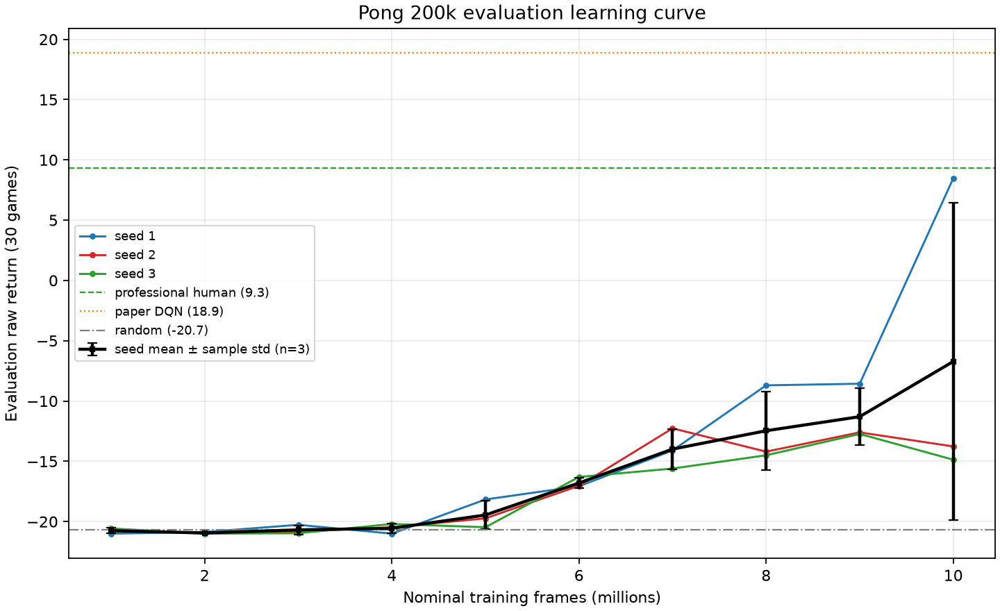

# Pong 200k 结果汇总

生成时间（UTC）：`2026-11-25T06:33:09.571220+00:00`
扫描目录：`runs`
参考容量：`200000`｜请求种子：`[1, 2, 3]`｜实际种子：`[1, 2, 3]`

## 需要处理

- 容量消融: 未找到 200000 以外的完整运行（依赖 Issue #27）

## Paper vs Ours

| 项目 | 最终 30 局原始分 | 种子数 | 说明 |
|---|---:|---:|---|
| 论文 DQN | 18.9 ± 1.3 | — | Extended Data Table 2 |
| **本复现** | **-6.722 ± 13.165** | 3 | 种子均值的均值 ± 样本标准差（ddof=1） |
| 专业人类 | 9.3 | — | 论文基线 |
| 随机策略 | -20.7 | — | 论文基线 |

人类归一化分数：**46.6%**（论文 DQN：132.0%）；预注册判定：**not supported: above random but not positive**。

## 逐种子最终结果

| Seed | 运行目录 | 最终帧 | 局数 | 最终均值 | 总体标准差 | 归一化 | 耗时 (s) | 峰值 RSS (GiB) | 检查点 SHA-256 |
|---:|---|---:|---:|---:|---:|---:|---:|---:|---|
| 1 | `runs/seed1_cap200k_complete` | 10000000 | 30 | 8.467 | 7.894 | 97.2% | 11690.3 | 6.28 | `d69c13b900d9…` |
| 2 | `runs/seed2_cap200k_complete` | 10000000 | 30 | -13.767 | 4.153 | 23.1% | 3566.2 | 6.27 | `7444566305ef…` |
| 3 | `runs/seed3_cap200k_complete` | 10000000 | 30 | -14.867 | 3.243 | 19.4% | 2217.7 | 6.50 | `aaed2754db34…` |

## 学习曲线

曲线按每 1M 名义训练帧的 30 局评测均值绘制；阴影/误差条为跨种子样本标准差。

## 容量消融

未接入：没有 50k/100k 的完整配对运行；该部分依赖 Issue #27。

## 失败搜索

未接入：尚未找到 Issue #25/#26 的失败开局清单与等预算对照产物

## 产物

- `summary.json`：机器可读的完整汇总与警告
- `per_seed.csv`：逐种子最终结果
- `learning_curve_per_seed.csv`：每种子逐轮评测
- `learning_curve_aggregate.csv`：共同评测帧上的跨种子均值与样本标准差
- `learning_curve.png`：学习曲线图
