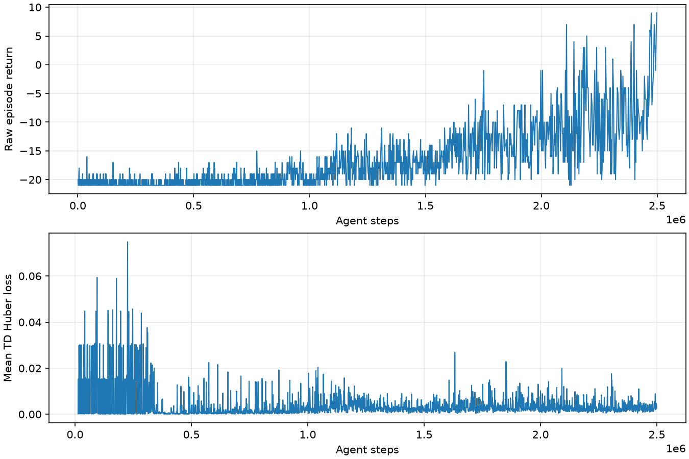
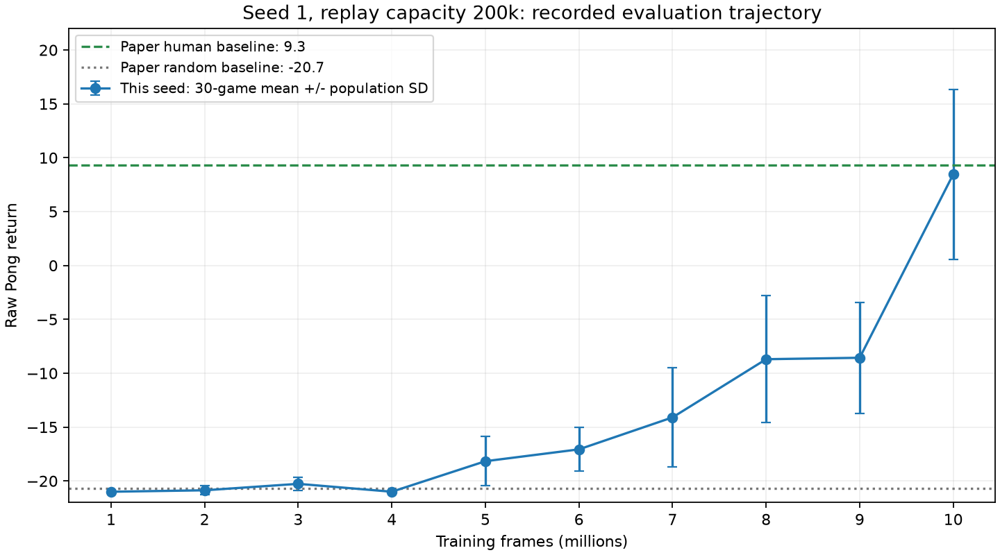

# DQN 復現項目：實作與驗收記

**提交人：陈博文　學號：2260031814**

開發與驗收期間：2026-11-15 至 2026-11-16。

本次承接 QNetwork 與小組既有基礎模組，完成 Agent、Evaluator、Runner 實作、八模組聯調及首種子完整訓練。程式、數值測試、安裝驗證、實驗紀錄與論文對照，俱納入本次提交，提請審閱。

## 一、實作所成

| 模組 | 本次工作與所得 |
|---|---|
| Config | 修正 Python 聯合型別與可選數值解析；檢查未知欄位、整數覆蓋及跨模組參數一致性 |
| EnvFactory | 完成訓練與評測獎勵分流；評測保留原始得分；支援關閉隨機 NOOP 起始 |
| ReplayBuffer | 沿用小組環形緩衝區與截斷末幀修正，驗證採樣、覆寫及終止狀態銜接 |
| QNetwork | 承接本人 PR #16 的 Nature CNN；驗證輸入歸一化、輸出形狀、參數量與反向傳播 |
| Agent | 實現 ε-greedy、目標網路、TD 更新、centered RMSProp、參數與探索狀態保存 |
| Trainer | 沿用小組步驅動迴圈；完成更新次數、target 同步、截斷及原始回報的整合驗證 |
| Evaluator | 完成獨立環境、獨立探索亂數、30 局評測、均值／標準差及人類歸一化；PR #20 已合併 |
| Runner | 完成 CLI/YAML 組裝、5k 冒煙模式、TensorBoard/JSON、速度與記憶體紀錄、定期評測及繪圖 |

核心更新使用 `r + γ·max Q_target(s′)·(1−done)`，TD 誤差導數裁至 `[−1,1]`。RMSProp 依公開 DeepMind 公式維護梯度均值與平方均值，epsilon 位於平方根內；反向傳播採批次求和，日誌記錄批次平均損失。數值測試逐步對照獨立標量計算。

針對 Windows 讀檔期間可能占用 `progress.json` 的情形，加入有界重試並以模擬占用測試驗證。對設定允許的 `eps=0`，補入零梯度保護；本次完整實驗使用 `eps=0.01`。

## 二、驗證所據

| 驗證項 | 實測結果 |
|---|---|
| 全套回歸測試 | 新建 Conda 環境依 README 安裝，**60 項通過，34.83 秒** |
| 數值與介面 | 覆蓋 ε 的幀數換算、TD 裁剪、終止掩碼、target 複製、優化器方程及設定覆蓋 |
| 訓練與評測整合 | 驗證截斷末幀、更新／同步次數、評測隔離、原始得分與產物生成 |
| 兩次 GPU 5k 冒煙 | 各完成 5,000 步、1,187 次更新；在線／目標網路張量逐元素相同，評測結果一致 |
| GPU 冒煙效率 | 訓練各耗時 16.64／16.55 秒；末次紀錄 304.4／286.9 SPS，RSS 約 1.15 GiB |
| 新環境 CPU 5k 冒煙 | 完成 5,000 步；訓練 69.17 秒，末次紀錄 69.2 SPS，RSS 0.43 GiB |

CPU 冒煙與完整 GPU 訓練並行執行；表中時間為當時實測值。同種子一致性比較採相同機器與套件版本。

## 三、首種子完整實驗

| 項目 | 紀錄 |
|---|---|
| 遊戲／種子／回放容量 | Pong／seed 1／200,000 |
| 運算設備 | 本機 NVIDIA RTX 3080 Laptop GPU |
| 訓練完成量 | **2,500,000 決策步；10,000,000 名義原始幀；621,875 次梯度更新** |
| 評測安排 | 每 1M 訓練幀評測一次，共 10 輪，每輪 30 局 |
| 最終原始得分 | **8.466667 ± 7.894020**，標準差按本輪 30 局總體計算 |
| 人類歸一化得分 | **97.222%**；Pong 論文基準：隨機 −20.7，人類 9.3 |
| 訓練迴圈牆鐘（含定期評測） | 11688.96 秒，合 3.247 小時 |
| 進程峰值 RSS | 6.28 GiB，依日誌採樣 |

各輪評測如下；橫向比較使用同一遊戲、種子、容量與評測規則。

| 訓練幀（百萬） | 30 局均值 | 總體標準差 | 人類歸一化 |
|---|---:|---:|---:|
| 1 | -21.000 | 0.000 | -1.00% |
| 2 | -20.867 | 0.427 | -0.56% |
| 3 | -20.267 | 0.629 | 1.44% |
| 4 | -21.000 | 0.000 | -1.00% |
| 5 | -18.167 | 2.296 | 8.44% |
| 6 | -17.067 | 2.015 | 12.11% |
| 7 | -14.100 | 4.607 | 22.00% |
| 8 | -8.700 | 5.883 | 40.00% |
| 9 | -8.567 | 5.143 | 40.44% |
| 10 | 8.467 | 7.894 | 97.22% |

完整實驗採 `d3b95ba` 所載訓練實作。首次執行的檔案占用問題修復後，本次由初始化重新訓練至預定步數；初次紀錄另存 `runs/seed1_cap200k_full/`，供修正溯源。

## 四、論文對照與審閱綱目

論文參數表、公開 Torch7 實作及本項目契約分列於 `docs/paper-code-audit.md`。預熱、探索退火與 target 同步的時鐘逐項對照；本次採用既定項目契約。預熱期 ε 從 1.0 漸降至約 0.955，此項與論文均勻隨機預熱的差異亦列入實驗設定。

- **Agent 整合：** 與組員 PR #22（對照版本 `73a54c2`）共同審閱，統一優化器數值口徑及介面。
- **交叉驗收：** #9／#11／#12／#13 對應非實作者的交叉檢查；本次提交測試與實測紀錄，供組員復核並完成簽核。
- **後續實驗：** 三種子統計與 50k／100k／200k 回放容量比較，承接本次完整流程開展。

## 五、成果索引

- `docs/implementation-report.md`：本次開發與驗收彙報，附訓練及評測曲線。
- `docs/validation.md`：測試、雙次冒煙、新環境驗證與完整實驗數據。
- `docs/full-implementation.md`：模組組裝、數值方程、使用方法與整合說明。
- `docs/paper-code-audit.md`：論文、公開原版程式及項目契約對照。
- `runs/seed1_cap200k_complete/`：設定、環境、事件日誌、逐項指標、逐局得分、最終結果及驗證紀錄。
- `tests/`：數值回歸、模組介面及端到端驗證。模型權重另存本機，程式與實驗紀錄入庫。

## 六、實驗圖錄

